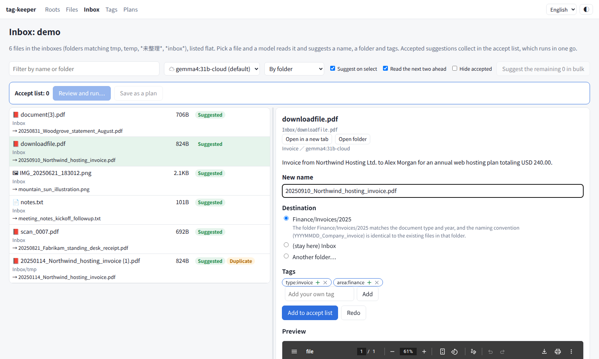
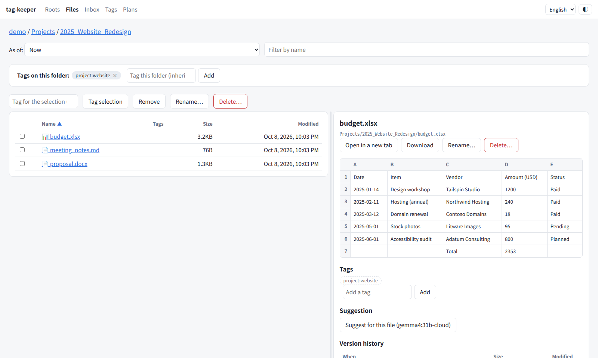
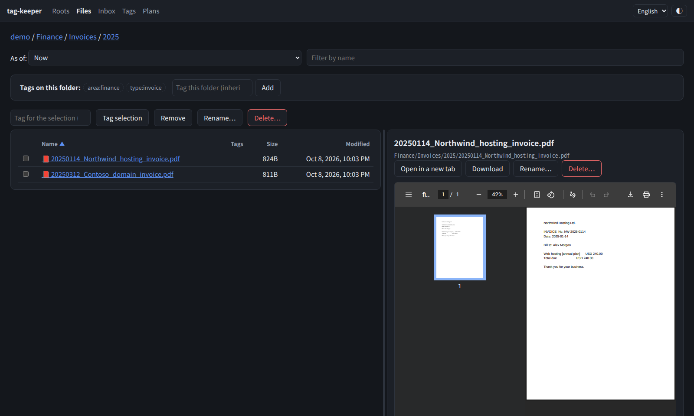
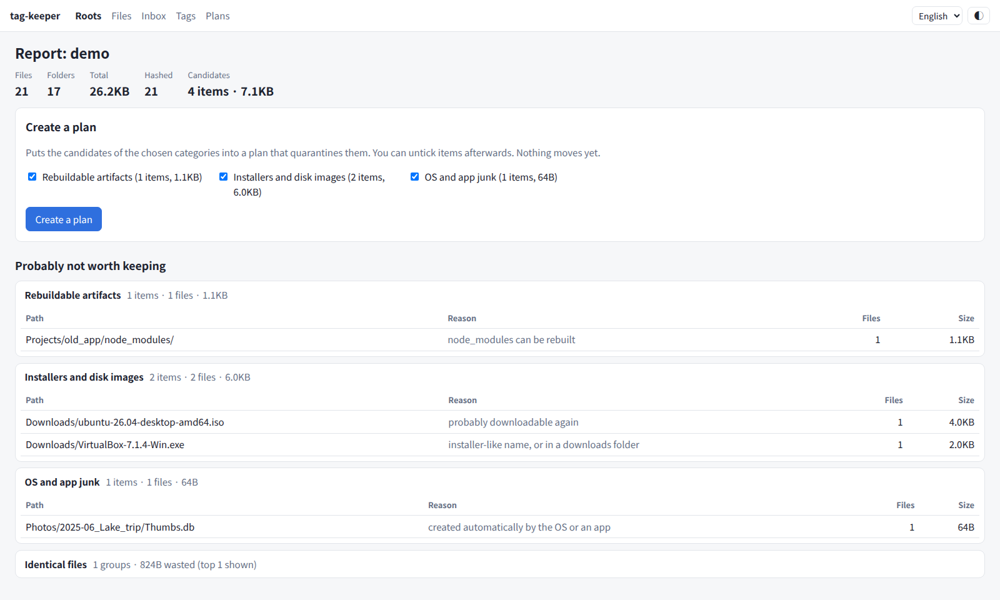
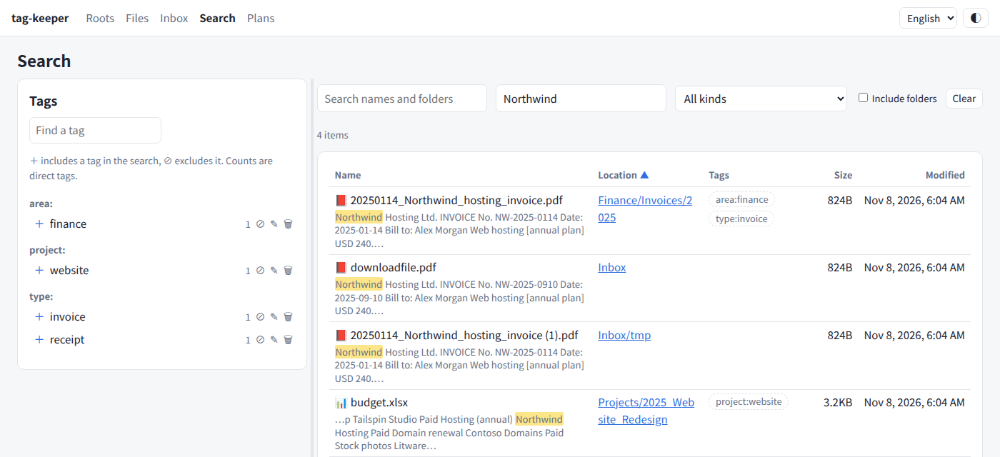

# tag-keeper

既存のフォルダ構造を動かさずに、外側からタグ付け・検索・整理を行うツールです。

[English README](README.md)

> **状況: プレアルファ版。** 今動くのは、棚卸し（走査・内容ハッシュ・衛生レポート）、
> 承認した整理プランによる片付け（取り消し可能）、タグと btrfs スナップショットの版の履歴つきのファイルブラウザ、
> 名前・本文（スキャンは OCR）・タグでの検索、手元のモデルによる受け皿のファイルの名前と移動先の提案です。
> タグの別名・親子・型付きの属性はこれから作ります。[ロードマップ](#ロードマップ) を参照してください。



| ファイルブラウザ（Office のプレビュー） | ダークモード | 衛生レポート |
|---|---|---|
|  |  |  |



*スクリーンショットは架空の見本のデータ（`scripts/make_demo.py`）で撮っています。画面は英語に切り替えています。*

## なぜ作るのか

多くの文書管理ソフトは、ファイルを取り込んで自分の保管場所に一律に並べ直します。
これは、クラウドドライブの実際の使い方と正反対です。フォルダには既に意味があります
（番号付きの案件フォルダ、独自の構成を持つソースコードのリポジトリ、年月で分けた保管庫など）。
その意味はフォルダごとに決まっていて、全体共通のカテゴリでは表せません。

tag-keeper はツリーに手を付けません。ツリーの外に自分の台帳（カタログ）を持ち、そこからツリーをきれいに保つ手助けをします。

- **ファイルを取り込まない。** コピー・改名・変換をしません。ファイラーやシェルはこれまでどおり使えます。
- **ツールの外での操作に追従する。** 移動・改名したファイルも、記録を引き継ぎます。
- **変更は提案として出す。** ファイルを動かす操作はプランとして書き出し、先に示して、承認されてから実行します。
  削除はしません。隔離フォルダへ移すだけで、プランごとに取り消せます。

## 今できること

```console
$ tag-keeper scan ~/CloudSync/OneDrive     # 読み取り専用で走査し、カタログを更新する
$ tag-keeper hash ~/CloudSync/OneDrive     # 前回から変わったファイルだけ SHA-256 を計算する
$ tag-keeper report ~/CloudSync/OneDrive   # クラウドに置く価値が薄そうなものを報告する
$ tag-keeper extract                       # 書類の本文を取り出して、全文検索の索引に入れる
$ tag-keeper search --text 請求書          # 名前・本文（--text）・種類・タグで探す
```

- **scan** は、すべてのファイルとフォルダのパス・サイズ・更新日時・inode を記録します。
  移動・改名は inode で追跡するので、動かしたファイルも行（とハッシュ）を引き継ぎます。
  - 「ここで消えて、あちらに新しく現れた」形で届く移動（別の端末で改名したフォルダを rclone bisync が持ってきた場合などは inode が変わります）は、
    **hash** の後に内容ハッシュで結び付けます。一対一に決まるものだけを結び付け、配下のファイルがそろって動いたフォルダはフォルダ1件の移動として記録するので、
    タグと版の履歴が追従します。
  - **安全弁:** 一度に多くのファイルが消えたように見えたら（ドライブのマウントが外れた、同期クライアントの事故など）、
    削除として記録せずに**保留**します。次の走査でも見えなければ記録します（`--accept-missing` で即時に記録）。
  - ルートが存在しないか空なら、「全部消えた」と扱わずに走査を止めます。読めなかったフォルダの中身も、消えたとは扱いません。
- **hash** は、新しいファイルと変わったファイルだけ SHA-256 を計算します（進捗バーと残り時間を表示）。
  計算の途中で変わったファイルは飛ばします。
- **report** は、候補をカテゴリごとに、容量と例を添えて一覧します。
  - 同期フォルダに入り込んだアプリのデータ（ゲームのデータ、キャッシュ）。フォルダ単位で1件として報告し、
    条件に合う最も深いフォルダを選ぶので、隣にある利用者の書類まで巻き込みません
  - 作り直せる生成物（`node_modules`、`__pycache__` など）、仮想マシンのディスク、インストーラーとディスクイメージ、
    一時ファイル、Office のロックファイル
  - 同期の競合コピー（Linux 版 onedrive クライアントの `-safeBackup-`、pCloud の `[conflicted]`、
    rclone bisync の `.conflict1`、端末名の付いたもの、`(1)` 付きの複製）。同じフォルダに元のファイルがあるものだけです
    （元が無ければ、それが唯一の版かもしれないため）。元と内容が異なるものには「中身の確認が必要」と付けます
  - 空のファイルとフォルダ
  - 内容が同じファイル（ハッシュで確定したものだけ。サイズからの推測では報告しません）
  - 展開したフォルダが隣にある圧縮ファイル、後継版がある旧版（「前の版」の関係を張ったもの）、大きくて長く触れていないファイル
    （保管先の見直しの候補。確認が要る扱いで、プランには既定で含めません）
  - レポートの画面で、どの候補も理由を付けて「残す」にでき、以後は報告しません。検出ルールは `[hygiene] disabled` で止められます。
  - **構造の見直し**: 直下のファイルが多すぎるフォルダ、意味が重なっていそうな兄弟のフォルダ（数字の部分が同じもの）、番号付きのフォルダの番号の重複・欠番、
    日付の書式の混在、子が1つだけの入れ子の連鎖、中身がまったく同じフォルダ、中身の種類が混ざったフォルダを提案します。
    どれも提案だけで、保管・まとまり・アプリ管理の型のフォルダの中は見ません。

カタログはツリーの外の SQLite ファイルです（既定は `~/.local/share/tag-keeper/catalog.db`）。
ここまでのコマンドは、ツリーに何も書き込みません。

### 整理プランで片付ける

```console
$ tag-keeper plan onedrive                  # 報告の候補をプランのファイルに書き出す
$ $EDITOR ~/.local/share/tag-keeper/plans/<プラン ID>.toml   # 残したいものの行を消す
$ tag-keeper apply <プランのファイル>        # 確認だけ
$ tag-keeper apply <プランのファイル> --yes  # 隔離フォルダへ移す
$ tag-keeper undo <プラン ID> --yes         # すべて元に戻す
$ tag-keeper purge <プラン ID> --yes        # または: 隔離したものを完全に消す
```

- **plan** は、1件を1行にして、カテゴリごとにまとめて書き出します。`--category` でカテゴリを絞れます
  （`app-data`、`vm-image`、`conflict` など）。中身の確認が要る候補は、`--include-review` を付けたときだけ含めます。
- **apply** は、既定では確認だけです。`--yes` を付けると、各対象を `<quarantine_dir>/<プラン ID>/` の下へ、
  元の相対パスのまま改名で移します。移す直前に、プランの作成時から変わっていないか
  （inode・サイズ・更新日時、フォルダなら配下のファイル数と合計サイズも）を確かめ、変わっていれば飛ばして報告します。
- `snapper_config` を設定すると、実行の前に snapper の pre スナップショット、後に post スナップショットを撮ります。
  pre を撮れなければ、何も動かしません。
- 移した操作は、すべて実行記録（`~/.local/share/tag-keeper/journal/<プラン ID>.jsonl`）に追記します。
  **undo** はこの記録をもとに元へ戻します。元の場所に新しく別のものができていれば、上書きせずに飛ばします。
- 移すたびにカタログも更新するので、大量に隔離しても、次の走査で大量消失と誤認しません。
- 同期クライアントが消えたことに気付けば、クラウドからは消えます。ただし、隔離フォルダを空にするまでは、このディスクに残ります。
- **purge**（またはプランの画面の「隔離を空にする」。元に戻せないことを示す確認の後に実行）は、プランで隔離したものを完全に消します。
  前後にスナップショットを撮り、このプランは取り消せなくなります。シンボリックリンクはたどらず、リンクそのものを消します。
  隔離先が snapper の対象のサブボリュームの中にあるときは、隔離したものを含むスナップショットが消えるまで、ディスクの容量は戻りません。

### 大量の削除で同期を止めない

[Linux 版 onedrive クライアント](https://github.com/abraunegg/onedrive)は、子の多いフォルダ
（`classify_as_big_delete`、既定 1000 件）がローカルで消えると事故とみなし、同期をやめて終了します。
systemd で常駐させていると再起動のたびに同じ理由で終了するので、気付かないうちに同期が止まります。
利用者が承認した大量の削除では、tag-keeper が同期クライアントと連携します（ルートに `sync_client = "onedrive"` を設定）。

rclone を使う場合は `sync_client = "cloud-sync"`、`sync_service = "cloud-sync-<名前>.service"` を設定すると、
systemd の timer で定期実行する `rclone bisync` と連携します。timer を止め、動いている同期が終わるのを待ち、
隔離し、その実行に限り `--max-delete` を上げて1回同期して削除を反映し、timer を再開します。
ルートの画面には「今すぐ同期」ボタンが付き、同期中は全画面の上部に表示が出ます。
この表示には、cloud-sync のログから読み取った進み具合（段階・反映した件数・転送量・速さ・残り時間・最後に扱ったファイル・エラー）が出ます。

1. 常駐の同期を止める（`systemctl --user stop onedrive.service`）
2. 隔離する
3. `onedrive --sync` を1回だけ、しきい値を「このプランで一番大きいフォルダ」より少し上に上げて実行し、削除をクラウドに反映する。
   `--force` は使いません（関係のない事故まで通してしまうため）
4. 常駐の同期を再開する

3 が失敗したら、常駐の同期は止めたままにします（再開しても同じ理由で終了を繰り返すため）。
失敗は実行記録に残り、Web の画面か `tag-keeper sync <プラン ID> --retry` から再試行できます。
小さなプランでは連携せず、動いている同期クライアントにそのまま任せます。

## Web の画面

```console
$ tag-keeper serve                  # http://127.0.0.1:8090/
```

ここまでの操作は、すべてブラウザからできます。ルートを最新にする（走査とハッシュ計算）、レポートを見る、
プランを作る、残したいもののチェックを外す、確認する、実行する、取り消す。
時間のかかる処理は裏で動き、画面の下に、段階・進捗バー・速さ・残り時間・直近のログを表示します。スマートフォンでも使えます。
画面上部で、表示言語（日本語・英語。既定はブラウザの言語）とテーマ（OS に合わせる・ライト・ダーク）を切り替えられます。

- 既定ではループバックだけで待ち受けます。他のアドレス（Tailscale のアドレスなど）で待ち受けるには、
  BASIC 認証の資格情報を `--auth-file`（`user:password` の1行）か `TAG_KEEPER_AUTH` で渡してください。
  渡さなければ、`--allow-no-auth` を付けない限り起動しません。BASIC 認証は暗号化しないので、
  Tailscale などの VPN 越しか、TLS の後ろで使ってください。
- 書き込みは同一オリジンからだけ受け付けます。認証なしのときは、Host ヘッダが待ち受けているアドレスであることも確かめます（DNS リバインディング対策）。
- 同時に動かす処理は1つだけです。処理ごとのログは `~/.local/share/tag-keeper/logs/jobs/` にも残ります。
- **自動で最新に保ちます。** サーバーを動かしている間は、各ルートを 60 分ごとと cloud-sync の同期が終わるたびに最新にし（走査・ハッシュ計算・内容ハッシュでの移動の結び付け。`[scan]`）、
  書類の本文を裏で低い優先度で読み取って全文検索の索引に入れます（`[extract]`）。走査が古いときや、消失の確定を保留しているときは、ルートの画面に出します。

### ファイル・タグ・版の履歴

- **ファイルブラウザ**: ルートの中をフォルダごとにたどり、PDF・画像・音声・動画・テキストを画面の中でプレビューし、何でもダウンロードできます。
  見出しを押すと並べ替えができ、一覧とプレビューの境目はドラッグで動かせます（どちらもブラウザが覚えます）。
- **Office 文書のプレビュー**: 追加の道具なしで、Excel はシートごとの表、Word は見出し・段落・表・画像、PowerPoint はスライドごとに見られます。
  LibreOffice が入っていれば、PDF に変換してレイアウトどおりにも見られます。
- **ブラウザが直接は再生できない動画**（FLV・MKV・AVI・WMV・MPEG-TS、MP4 の中の HEVC など）は、ffmpeg で再生用の MP4 にして再生します。
  中が H.264 なら入れ物だけを替えるので速く、作ったものは保存するのでシークもできます。元のファイルはそのままです。
- **クラウドで開く**: Linux 版 onedrive クライアントで同期しているルートでは、ファイルやフォルダを OneDrive の Web 画面で、
  Office 文書をブラウザ版の Office で開くリンクを出します。
  画面の中で開くのはスクリプトを実行しない種類だけで、HTML や SVG はテキストとして見せ、それ以外はダウンロードにします。
  シンボリックリンクを含め、ルートの外には出ません。
- **フォルダの作成・移動・名前の変更・削除**: ファイルブラウザから行えます。移動は、チェックしたものの移動先を入力するか、フォルダの行やパンくずへドラッグします。
  名前の変更では、どのファイルやフォルダでも名前を変えられます。名前は自由に入力するか、提案の名前を使えます。
  削除は隔離フォルダへ移すだけです。どちらも1件ずつのプランとして実行するので、スナップショットと取り消しが効き、フォルダの名前を変えてもタグは追従します。
- **タグ**: ファイルブラウザから、ファイルやフォルダにタグを付け外しできます。フォルダのタグは配下に継承されます。
  タグは端末ごとの追記専用の JSONL（`~/.local/share/tag-keeper/tags/<ホスト名>.jsonl`）に記録するので、
  ツールが無くても読め、同期しても競合しません。タグの付いたものが（手作業でもプランでも）動いたら、移動を記録してタグを追従させます。
  パスは Unicode の NFC にそろえて引き当てるので、NFC と NFD（日本語の濁点など、2通りの書き方）のどちらで書かれても、同じものとして扱います。
- **フォルダの型とディレクトリカード**: フォルダには、ツールの扱い方を決める型を付けられます（まとまり・アプリ管理・日付分割・番号付き・受け皿・保管・除外・通常）。
  付けていないフォルダは、中身（`.git`・`.obsidian`・`2025` や `01_…` のような子の名前・受け皿らしい名前）から推定します。付けた型は中のフォルダが継承します（「通常」で止められます）。
  まとまり・アプリ管理の中は移動先の候補にせず、受け皿の型は名前に関係なく「整理」の画面の対象にし、除外は走査しません。
  ディレクトリカードには、何を置く場所か・中の名前の付け方を書きます。モデルに下書きさせることもでき、整理の提案で移動先を選ばせるときにモデルへ渡します。
- **複製と入れ子のルート**: ルートの中の、別のルートの複製のフォルダ（`replicas = { "OneDrive" = "onedrive" }`）は、走査・重複検出・プランの対象から外します。
  ルートの中に別のルートとして設定したフォルダがあるときも、外側の走査から外します。
- **アイテム間の関係**: 前の版・派生元・添付先など（種類は自由に足せます）を、ファイルの詳細から張れます。関係も移動に追従し、取り消しで戻ります。
- **移動の確認**: 同じ内容のファイルが少し前に複数の場所から消えて1つ現れたときは、どれが動いてきたか決められないので、推測しません。
  ルートの画面の「移動の確認」から一覧を開き、動いてきた場所を選ぶと、そのタグ・属性・関係・版の履歴が引き継がれます。どれでもなければ「新しいファイル」を選んでください。
- **書き出しと読み込み**: 管理情報の全量（タグ・属性・関係・タグの辞書・保存した検索）を `tag-keeper export` / `import` で JSONL に書き出し・読み込みできます（`/api/export` でも取れます）。
  読み込みでは、既にあるものは飛ばします。
- 画面でできることは、CLI からもできます: `tag-keeper tags`・`tag`・`alias`・`parent`・`attr`・`relate`・`export`・`import`。
- **検索**: 「検索」の画面で、名前・フォルダ、書類の中の文字（本文）、種類（書類・PDF・Office・画像・動画など）、タグを自由に組み合わせて探せます。
  本文で探せるのは PDF・Office・テキストで、文字の無いスキャンの PDF は tesseract が入っていれば OCR で読み取ります。
  本文は内容ハッシュをキーに SQLite の FTS5 の索引（trigram。日本語を単語に区切らずに探せます。1〜2文字の語は索引を使わずに探します）に入れ、
  結果では一致したところに印を付けます。`node_modules` のような作り直せるフォルダや、アプリのデータの中は索引に入れません。
- **絞り込み**: 場所（フォルダ）・更新日・大きさ・属性で絞り込めます。同じ内容のファイルは1行にまとめ（ほかの場所はその下に並べます）、
  今は無いもの（消えた・別の場所へ動いた前のパス）も含めて探せます。条件は名前を付けて**保存**でき、画面の上に今の件数つきで並ぶので、作業リストとして使えます。
- **タグの検索と管理**: 同じ画面で、タグの一覧を絞り込み、複数のタグで探せます（すべて含む・どれかを含む・除外）。
  フォルダに付いたタグは中のものにも効きます。タグの名前は全体で一度に変えられ（既にあるタグの名前にすると1つにまとめます）、削除もできます。
  結果のファイルは、その場でプレビューできます。
- **タグの別名と親子**: 別名（「会社:アティード」に対する「会社:ATID」）は、付けるときも探すときも正式な名前にそろえます。既に使われている名前を別名にすると、正式な名前にまとめます。
  親子（「種別:請求書」→「種別:経理」）を登録すると、親のタグで探したときに、子のタグが付いたものも見つかります。循環する登録は断ります。
- **型付きの属性**: 択一（対応状態: 未対応 / 対応中 / 対応済み）・フラグ・日付・数・文字の属性を定義して、ファイルブラウザや検索の結果から、ファイルやフォルダに付けられます。
  択一は値を1つだけ持ち、フォルダに付けた値は中のものが継承します。タグと同じく、移動に追従し、取り消しで戻ります。
- **版の履歴**: [btrfs-timeline](https://github.com/akivajp/btrfs-timeline) を使い、btrfs のスナップショットから、
  ファイルの版の一覧、過去のある時点のフォルダの中身（今は消えたものを含む）を見られます。
  過去の版は、今のファイルの隣に日時付きの別名で復元します（上書きしません）。
  tag-keeper が見た移動・改名を記録しているので、移動・改名の前の版もたどれます。

### 書類・画像の読み取り（確認の画面）

モデルに書類の本文を読ませて、書類の種類・日付・相手・金額・期限・必要な対応・分類のラベル・要約を取り出せます。
画像は、画像を読めるモデルで書類か写真かと内容を説明させ、その説明を全文検索の索引に入れるので、写真も写っているもので探せます。
結果は提案として「確認」の画面に並び、要らないものの印を外して承認する（タグと属性が出所「ai」で付きます）か、却下します。1件ずつでも、まとめてでもできます。
読み取りは「確認」の画面かファイルの詳細から始めます。`[ai] auto = true` にすると、新しいものを裏で読み取ります。

内容を外部へ出してはいけないルート（業務のファイルなど）には `allow_cloud = false` を書いてください。
そのルートでは、クラウドのモデル（`…:cloud`）の代わりに `[organize] local_model` を使います（整理の提案・ディレクトリカードの下書き・読み取りのすべて）。

### 音声・動画の書き起こし

任意の追加の依存 `transcribe`（`pipx install 'tag-keeper[transcribe]'`。GPU で動かすなら cuDNN・cuBLAS も pip で入る `[transcribe-gpu]`）を入れると、
音声・動画を faster-whisper で書き起こします。言語は自動で判定し、区間ごとの時刻つきの文を全文検索の索引に入れるので、話した内容で録音を探せます。
ファイルの詳細か `tag-keeper transcribe` から始めます。`[transcribe] auto = true` にすると、新しい録音を裏で書き起こします。
書き起こしは別のプロセスで動かします（cuDNN を読めない GPU のプロセスは、例外ではなくプロセスごと落ちるため）。落ちたら CPU でやり直すので、Web の画面は巻き込まれません。
無音の区間に定型文をでっち上げやすいので、発話の検出のしきい値を下げ（0.2）、無音らしい区間は捨てます。

### 受け皿の整理の提案

名前が `inbox_patterns`（既定は `tmp`・`temp`・`*未整理*`・`*inbox*`）に一致するフォルダを受け皿とみなします。
「整理」の画面に、受け皿の中のファイルをフォルダの階層なしで並べます。ファイルを選ぶと、
[ollama](https://ollama.com/) のモデルが内容を読み（PDF や Office 文書は文字、写真やスキャンの PDF は画像そのもの）、
多くは数秒で次を提案します。

- 名前: 既定は `YYYYMMDD_題名`。過去の判断や、移動先のフォルダの日付の付け方に合わせ、意味のある今の名前は尊重します
- 移動先: 既存のフォルダから最大3つ。各フォルダのパスと中のファイル名の文字の2文字組（TF-IDF）で候補を絞ってから、モデルが選びます。
  年・月のフォルダは、書類の日付の年・月に置き換えます
- タグ: 既に使っているタグを優先します。新しいタグには「新規」と付けます

選んだファイルは待ち行列の先頭に割り込み、次の2件は先読みします。採用した提案は採用リストにたまり、
1つの「移動・改名」のプランとして実行するか（スナップショットと取り消しつき）、プランとして保存して確かめてから実行します。
受け皿の外のファイルは、ファイルブラウザで頼んだときだけ提案を作ります。

**判断から学ぶ仕組み**: 採用したもの（提案と最終的な名前・移動先・タグ）、提案されたタグを付けた・却下したこと、取り消したプランを、
端末ごとの JSONL（`~/.local/share/tag-keeper/decisions/`）に追記します。受け皿から手作業で移したものも例に使います。
提案を作るときは、似た過去の判断を例として指示文に添え、その移動先を候補に入れます。何度も却下したタグは使わせません。
ログは提案と判断が対になっているので、そのまま学習データとして書き出せます。

**モデル**: 既定は手元のモデルです。画面や設定で ollama のどのモデルも選べ、ollama のクラウドのモデル（`…:cloud`・`…-cloud`）も使えます。
その場合、ファイルの内容は ollama のクラウドに送られます。画面ではクラウドのモデルに ☁ を付けます。
提案は内容ハッシュとモデルごとに保存するので、同じファイルを同じモデルで読むのは1回だけです。

## インストール

Python 3.11 以上と Linux が必要です。Web の画面は日本語と英語に対応しています（既定はブラウザの言語で、画面上部で切り替えられます）。コマンドのメッセージは日本語です。

```console
$ pipx install tag-keeper        # または: uv tool install tag-keeper
$ tag-keeper --help
```

次の道具は任意で、それぞれ必要な機能でだけ使います。

| 道具 | 使う機能 |
|---|---|
| poppler-utils（`pdftotext`・`pdftoppm`） | 全文検索と受け皿の整理の提案での PDF の読み取り |
| tesseract-ocr（日本語は `jpn`） | 全文検索のための、スキャンの PDF の OCR |
| [ollama](https://ollama.com/) | 受け皿の整理の提案 |
| btrfs と snapper | 版の履歴、プランの実行前後のスナップショット |
| Linux 版 onedrive クライアント | 大量の削除での同期との連携、OneDrive の Web 画面へのリンク |
| LibreOffice | Office 文書のレイアウトどおりのプレビュー（PDF） |
| ffmpeg | FLV・MKV・AVI など、ブラウザが直接は再生できない動画の再生 |
| faster-whisper（`[transcribe]`・`[transcribe-gpu]`） | 音声・動画の書き起こし |

ソースから使う場合:

```console
$ git clone https://github.com/akivajp/tag-keeper.git
$ cd tag-keeper
$ uv run tag-keeper --help
$ uv run --extra dev pytest
```

## 設定

任意です。`~/.config/tag-keeper/config.toml`:

```toml
[[roots]]
name = "onedrive"
path = "~/CloudSync/OneDrive"
exclude = ["*.partial"]              # 走査しない（ルートからの相対パスに対する glob）

[hygiene]
allow = ["archive/**"]               # 報告しない（「残す」と判断したもの）
device_names = ["zefat", "hermon"]   # 同期クライアントが競合コピーに付ける端末名
app_data_names = ["MyLauncher"]      # 既定に加えて、アプリのデータとみなすフォルダ名

[safety]
mass_missing_ratio = 0.2             # これを超える割合が消えたら、削除の記録を保留する
mass_missing_min = 100

[plan]
quarantine_dir = "~/.local/share/tag-keeper/quarantine"  # ルートと同じファイルシステムに置く
snapper_config = "home"              # 前後のスナップショットを撮る snapper の設定名（"" で撮らない）

[scan]
auto_refresh = 60                    # serve を動かしている間、この間隔（分）で各ルートを最新にする（0 で止める）
after_sync = true                    # cloud-sync の同期が終わるたびにも、そのルートを最新にする
relink_days = 30                     # 内容ハッシュで移動を結び付けるとき、何日前までに消えたものを相手にするか（0 で探さない）

[extract]
enabled = true                       # serve を動かしている間、書類の本文を読み取って全文検索の索引に入れる
ocr = true                           # tesseract があれば、文字の無いスキャンの PDF を OCR にかける
ocr_images = false                   # 画像も OCR にかける（時間がかかり、写真では意味の無い文字を拾う）
ocr_lang = "jpn+eng"                 # tesseract の言語（縦書きも読むなら "jpn+jpn_vert+eng"）
ocr_pages = 3                        # OCR にかける PDF のページ数（先頭から）
max_chars = 50000                    # 1ファイルから保存する本文の上限（文字数）
max_mb = 200                         # これより大きいファイルは読まない（MB）
```

同期クライアントとの連携は、ルートごとに設定します。

```toml
[[roots]]
name = "onedrive"
path = "~/CloudSync/OneDrive"
sync_client = "onedrive"             # ""（既定）なら連携しない / "cloud-sync" = rclone bisync の timer
sync_service = "onedrive.service"    # `onedrive --monitor` を動かしている systemd --user のユニット
sync_guard = "auto"                  # "auto": 大量削除のときだけ / "always": 実行のたびに
replicas = { "OneDrive" = "onedrive" }  # 中のフォルダが別のルートの複製なら（走査しない）
allow_cloud = true                   # false: このルートの内容をクラウドのモデルへ送らない
```

タグと受け皿の整理の提案:

```toml
[tags]
dir = "~/.local/share/tag-keeper/tags"   # 端末ごとのタグのログの置き場所

[organize]
inbox_patterns = ["tmp", "temp", "*未整理*", "*inbox*"]  # フォルダ名に照合する（大文字・小文字を区別しない）
ollama_url = "http://127.0.0.1:11434"
model = "gemma3:12b"                     # 例: "gemma4:31b-cloud"（内容が ollama のクラウドに送られる）
vision_model = ""                        # model が画像を読めないときに、画像を読むモデル
model_choices = ["gemma4:31b-cloud"]     # 画面で選べるモデルの候補
local_model = "gemma3:12b"               # allow_cloud = false のルートで、クラウドのモデルの代わりに使う
think = ""                               # 思考に対応したモデルで "true" / "false"。空ならモデルに任せる
use_images = true
max_chars = 4000                         # モデルに渡す本文の上限
candidates = 15                          # モデルに選ばせる移動先の候補の数

[transcribe]
auto = false                             # 新しい音声・動画を裏で書き起こす
model = "large-v3-turbo"                 # faster-whisper のモデル
device = "auto"                          # auto（使えれば GPU）・cuda・cpu
language = ""                            # 空なら自動で判定
vad_threshold = 0.2                      # 下げるほど小さな声も拾う（下げすぎると物音に作文する）
max_minutes = 240                        # これより長いものは書き起こさない

[ai]
auto = false                             # 新しい書類・画像を裏で読み取る
images = true                            # 画像の内容も推定する（画像を読めるモデルが要る）
batch = 10                               # 裏の処理の1回で読み取る件数
```

ルートを設定しておけば、`tag-keeper scan`（引数なし）で全ルートを走査します。
どのコマンドも `--log-file PATH` で日時付きのログを残せます。

## ロードマップ

1. **棚卸しと衛生レポート**、承認したものを隔離する整理プラン（snapper のスナップショットと取り消しつき）（済み）
2. **タグと検索** — 済み: フォルダから継承するタグ（追記専用ログ）、ファイルブラウザ、移動をまたぐ版の履歴（内容ハッシュで見つけた移動を含む）、
   タグ・名前・種類・本文による検索。これから: タグの別名・親子、型付きの属性、検索条件の保存
3. **内容の抽出** — 済み: 全文検索のための PDF・Office 文書の文字とスキャンの OCR、受け皿の提案のための手元のモデルによる画像の読み取り。
   これから: 音声・動画の書き起こし
4. **配置と構造** — 済み: 受け皿のファイルの名前と移動先の提案。これから: ディレクトリカード、構造の見直し

## ライセンス

MIT
