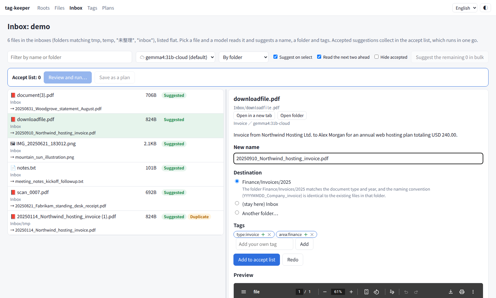
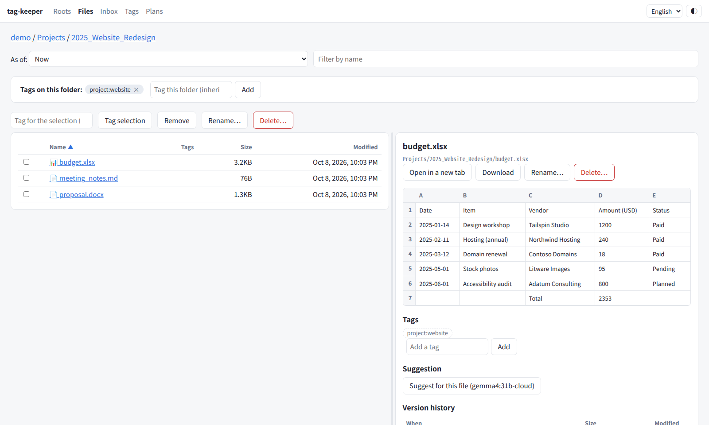
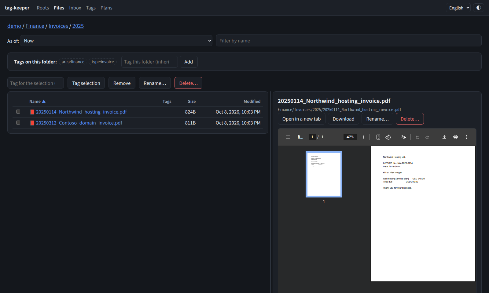
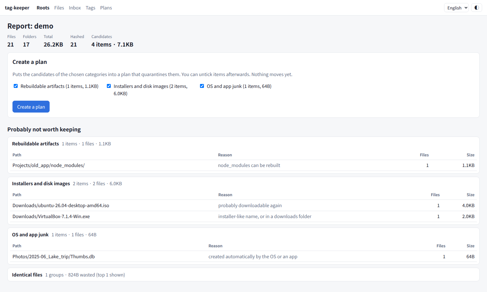
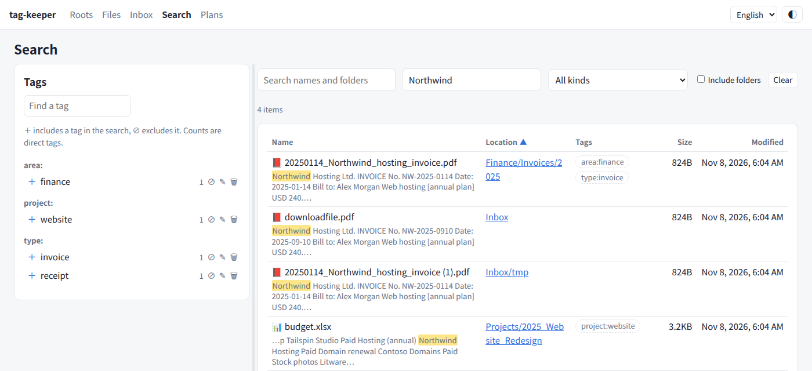

# tag-keeper

Tag, search and tidy your existing file trees from the outside — without moving a file.

[日本語版 README はこちら](README.ja.md)

> **Status: pre-alpha.** What works today: the inventory (scanning, content hashing, a
> hygiene report), cleaning up with plans you approve (with undo), a file browser with tags
> and version history from btrfs snapshots, search by name, full text (with OCR for scans)
> and tags, and name and folder suggestions for your inbox folders from a local model.
> Tag aliases, parents and typed fields come next. See [Roadmap](#roadmap).



| File browser with Office preview | Dark mode | Hygiene report |
|---|---|---|
|  |  |  |



*Screenshots use made-up demo data (`scripts/make_demo.py`).*

## Why

Most document managers take ownership of your files: they ingest them into their own
storage and lay them out flat. That is the opposite of how a cloud drive is actually
used. Its folders already mean something — a numbered project folder, a source code
repository with its own layout, a year/month archive — and that meaning lives in each
folder, not in one global category tree.

tag-keeper leaves the tree alone. It keeps its own catalog next to the tree, and from
there it helps you keep the tree clean:

- **It never takes ownership.** No copying, renaming or converting. You keep using your
  file manager and shell as before.
- **It follows what you do outside it.** Files you move or rename keep their records.
- **Changes are proposals.** Anything that would move a file is written down as a plan,
  shown first, and only runs once you approve it. Nothing is ever deleted: files go to a
  quarantine folder, and every plan can be undone.

## What it does today

```console
$ tag-keeper scan ~/CloudSync/OneDrive     # read-only walk; updates the catalog
$ tag-keeper hash ~/CloudSync/OneDrive     # SHA-256 of files that changed since last time
$ tag-keeper report ~/CloudSync/OneDrive   # what is probably not worth keeping in the cloud
$ tag-keeper extract                       # read the text of documents into the full-text index
$ tag-keeper search --text invoice         # search by name, text (--text), kind and tags
```

- **scan** records path, size, mtime and inode of every file and folder. Renames and
  moves are tracked by inode, so a moved file keeps its row (and its hash).
  - Moves that arrive as "deleted here, new there" — a folder renamed on another device and
    brought in by rclone bisync, for instance, gets new inodes — are matched by content
    hash after **hash**: only one-to-one matches, and a folder whose files all moved is
    recorded as one folder move, so tags and version history follow it.
  - **Safety valve:** if a large share of files vanishes at once — an unmounted drive, a
    sync client accident — the deletions are *held*, not recorded. They are recorded only
    if they are still missing on the next scan (or with `--accept-missing`).
  - A root that is missing or empty aborts the scan instead of looking like "everything
    was deleted". Folders that cannot be read are not treated as gone either.
- **hash** computes SHA-256 only for files that are new or changed, with a progress bar
  and ETA. A file that changes while being hashed is skipped.
- **report** lists candidates by category, with sizes and examples:
  - application data that slipped into a synced folder (game data, caches) — reported
    once per folder, at the deepest folder that matches, so it never swallows your own
    documents next to it
  - rebuildable artifacts (`node_modules`, `__pycache__`, …), VM disk images, installers
    and disk images, temporary files and Office lock files
  - sync conflict copies (OneDrive for Linux `-safeBackup-`, pCloud `[conflicted]`,
    rclone bisync `.conflict1`, device-name suffixes, `(1)` copies) — only when the
    original sits next to it, since a lone "copy" may be the only version. Copies whose
    content differs from the original are marked as needing review
  - empty files and folders
  - exact duplicates, confirmed by hash (never guessed from size)
  - archives next to the folder they were extracted to, versions superseded by a newer one
    (from a *previous version* relation), and large files untouched for a long time (as
    candidates for other storage; these need review and stay out of plans by default)
  - **Keep** any candidate with a reason (from the report page) and it stops being reported;
    rules can be turned off with `[hygiene] disabled`.
  - **Structure review**: folders with too many files, sibling folders whose names overlap
    (`invoices` / `Invoices2`… with the same digits), duplicate or missing numbers in numbered
    folders, mixed date formats, chains of single subfolders, identical folders and folders
    mixing kinds of files. These are suggestions only; archive, bundle and app-managed folders
    are not reviewed.

The catalog is an SQLite file outside the tree (`~/.local/share/tag-keeper/catalog.db` by
default). None of these commands writes into the tree.

### Cleaning up with a plan

```console
$ tag-keeper plan onedrive                  # write the report's candidates to a plan file
$ $EDITOR ~/.local/share/tag-keeper/plans/<plan-id>.toml   # delete the lines you want to keep
$ tag-keeper apply <plan file>              # preview only
$ tag-keeper apply <plan file> --yes        # move them to the quarantine folder
$ tag-keeper undo <plan-id> --yes           # put everything back
$ tag-keeper purge <plan-id> --yes          # or: delete the quarantined items for good
```

- **plan** writes one line per item, grouped by category. `--category` limits it to some
  categories (`app-data`, `vm-image`, `conflict`, …). Candidates that need review stay out
  unless you pass `--include-review`.
- **apply** previews by default. With `--yes` it moves each item, by rename, to
  `<quarantine_dir>/<plan-id>/` under its original relative path. Right before each move
  it checks that the item has not changed since the plan was written (inode, size,
  modification time, and for folders the file count and total size); changed items are
  skipped and reported.
- With `snapper_config` set, a snapper *pre* snapshot is taken before the run and a *post*
  snapshot after it. If the pre snapshot fails, nothing is moved.
- Every move is appended to a journal (`~/.local/share/tag-keeper/journal/<plan-id>.jsonl`).
  **undo** reads the journal and moves items back; it never overwrites something that has
  appeared at the original path since.
- The catalog is updated as items move, so the next scan does not mistake a large
  quarantine for a mass disappearance.
- Items leave the cloud when the sync client notices they are gone, but they stay on this
  disk, in the quarantine folder, until you empty it.
- **purge** (or *Empty quarantine* on the plan page, after a confirmation that says it cannot
  be undone) deletes a plan's quarantined items for good, with snapshots before and after;
  the plan can no longer be undone. Symlinks are deleted, never followed. If the quarantine
  folder is inside a snapper-managed subvolume, the space only comes back once the
  snapshots that still hold the items expire.

### Big deletions without stopping your sync client

The [OneDrive client for Linux](https://github.com/abraunegg/onedrive) treats the local
removal of a folder with many children (`classify_as_big_delete`, 1000 by default) as an
accident: it refuses to sync and exits. Run under systemd, it keeps exiting on every
restart, so syncing silently stops. When *you* approve a big deletion, tag-keeper
coordinates with the client instead (set `sync_client = "onedrive"` on the root):

1. stop the resident sync (`systemctl --user stop onedrive.service`),
2. quarantine the items,
3. run one `onedrive --sync` with the threshold raised just above the largest folder in this
   plan — not `--force`, which would also let unrelated accidents through,
4. start the resident sync again.

Prefer rclone? Set `sync_client = "cloud-sync"` and `sync_service = "cloud-sync-<name>.service"`
to coordinate with an `rclone bisync` job run by a systemd timer instead: tag-keeper stops the
timer, waits for a running sync to finish, quarantines, runs one sync with a raised
`--max-delete` for that run only, and starts the timer again. The Roots page then shows a
*Sync now* button and every page shows a banner while a sync is running, with its progress read
from the cloud-sync log (phase, items applied, bytes transferred, speed, time left, the latest
file and errors).

If step 3 fails, the resident sync is left stopped (restarting it would only exit again),
the failure is journaled, and the web UI and `tag-keeper sync <plan-id> --retry` offer to
try again. Small plans are left to the running client as usual.

## Web UI

```console
$ tag-keeper serve                  # http://127.0.0.1:8090/
```

Everything above can be done in the browser: refresh a root (scan and hash), read the
report, create a plan, untick what you want to keep, check it, run it and undo it. Long
operations run in the background, and a panel at the bottom shows each step, a progress
bar, speed, time remaining and the latest log lines. It works on a phone too.
The top bar switches the language (Japanese or English; the browser's language by default)
and the theme (system, light or dark).

- Only loopback is served by default. To listen elsewhere (for example on a Tailscale
  address), give credentials for HTTP Basic auth with `--auth-file` (one line,
  `user:password`) or `TAG_KEEPER_AUTH`; without them a non-loopback address is refused
  unless you pass `--allow-no-auth`. Basic auth is not encrypted: use it over a VPN such as
  Tailscale, or behind TLS.
- Writes require a same-origin request, and without auth the `Host` header must name the
  bound address (against DNS rebinding).
- One job runs at a time. Each job also writes its own log under
  `~/.local/share/tag-keeper/logs/jobs/`.
- **Kept up to date by itself.** While the server runs, each root is refreshed (scan, hash
  and the content-hash move matching) every 60 minutes and after every cloud-sync run
  (`[scan]`), and documents are read into the full-text index in the background at low
  priority (`[extract]`). The Roots page warns when a scan is old or deletions are on hold.

### Files, tags and history

- **Browse** a root folder by folder, preview PDFs, images, audio, video and text in the
  page, and download anything. Columns sort by clicking the header, and the divider between
  the list and the preview can be dragged; both are remembered in the browser.
- **Office documents** preview without extra tools: Excel as tables with sheet tabs, Word
  as headings, paragraphs, tables and images, PowerPoint as slides. With LibreOffice
  installed they can also be shown as laid out, converted to PDF.
- **Videos the browser cannot play** (FLV, MKV, AVI, WMV, MPEG-TS, HEVC in MP4 and so on)
  are turned into an MP4 for playback with ffmpeg — only the container changes when the
  video is already H.264 — and cached, so seeking works.
- **Open in the cloud.** For a root synced by the OneDrive client for Linux, files and
  folders link to OneDrive on the web, and Office documents to Office for the web. Only types that cannot run scripts open in the page; HTML
  and SVG are shown as plain text, everything else downloads. Paths never leave the root,
  symlinks included.
- **Create folders, move, rename and delete** from the browser. Move ticked items by typing a
  destination or by dragging them onto a folder or the breadcrumbs. Type any name or take the
  suggested one; deleting moves items to the quarantine folder. Both run as one-off plans,
  with snapshots and undo, and a renamed folder keeps its tags.
- **Tag** files and folders from the browser. A folder's tags are inherited by everything
  under it. Tags live in append-only JSONL logs, one file per machine
  (`~/.local/share/tag-keeper/tags/<host>.jsonl`), so they stay readable without the tool
  and never conflict when synced. When a tagged item is moved — by you or by a plan — the
  log records the move and the tags follow. Paths are matched as NFC, so a name written in
  NFC or NFD (the two Unicode spellings of Japanese characters) points at the same item.
- **Folder types and directory cards.** Each folder can have a type that tells the tool how to
  treat it: *bundle* (a repository, an event's photos), *app-managed* (an Obsidian vault, a
  Zotero or Calibre library), *dated*, *numbered*, *inbox*, *archive*, *excluded* or *normal*.
  Folders without a type are guessed from their contents (`.git`, `.obsidian`, child names
  like `2025` or `01_…`, inbox-like names); a type you set is inherited by the folders inside
  (*normal* stops it). Bundles and app-managed folders are never offered as destinations,
  inbox folders join the Inbox page whatever their name, and excluded folders are not scanned.
  A directory card says what belongs in a folder and how files there are named; a model can
  draft it, and inbox suggestions show it to the model when choosing a destination.
- **Replicas and nested roots.** A folder inside a root that is a copy of another root
  (`replicas = { "OneDrive" = "onedrive" }`) is left out of scanning, duplicates and plans, and
  so is a folder that is itself configured as another root.
- **Relations between two items** (previous version, derived from, attached to, …; you can add
  your own kinds) can be linked from the file browser's details. They follow moves and come
  back with undo.
- **Moves needing your confirmation.** When several places lost a file with the same content
  just before a new one appeared, the tool cannot tell which one moved, so it does not guess.
  They are listed under *Confirm moves* (linked from the Roots page): pick the place it moved
  from to carry over tags, attributes, relations and version history, or say it is a new file.
- **Export and import** the whole management data (tags, attributes, relations, the tag
  dictionary, saved searches) as JSONL with `tag-keeper export` / `import` (also *Export* at
  `/api/export`). Importing skips what is already there.
- All of this is scriptable: `tag-keeper tags`, `tag`, `alias`, `parent`, `attr`, `relate`,
  `export`, `import` cover what the pages do.
- **Search** by name and folder, by the text inside documents, by kind (documents, PDF,
  Office, images, videos and so on) and by tags, in any combination. Full-text search covers
  PDF, Office and text files; scanned PDFs without text are read with tesseract when it is
  installed. Text is stored by content hash in an SQLite FTS5 index (trigram, so Japanese
  works without word splitting; one- and two-letter words are searched without the index),
  and the matches are highlighted in the results. Rebuildable folders such as `node_modules`
  and application data are left out.
- **Narrow it down** by folder, modification date, size and attributes; group identical
  files into one row (the other places are listed under it); include files that are gone —
  deleted, or moved away from that path — which link to the version history. **Save** any set
  of conditions under a name: saved searches sit at the top of the page with their current
  counts, as work lists.
- **Find and manage tags** on the same page: filter the tag list, search with several tags
  (all of them or any of them, minus excluded ones) — tags on a folder count for everything
  inside — and rename a tag everywhere (renaming onto an existing tag merges the two) or
  delete it. Results show a preview of the picked file.
- **Tag aliases and parents.** An alias (`company:ATID` for `company:Atid`) is folded into the
  real name when you tag and when you search; making a name that is already in use an alias
  merges it. A parent (`type:invoice` → `type:accounting`) makes every item with the child
  tag show up when you search for the parent; cycles are refused.
- **Typed attributes.** Define attributes once — a choice (`status`: to do / doing / done), a
  flag, a date, a number or text — and set them on files and folders from the file browser or
  from search results. A choice holds a single value, values set on a folder are inherited by
  everything inside it, and attributes follow moves and come back with undo, like tags.
- **Version history** comes from btrfs snapshots through
  [btrfs-timeline](https://github.com/akivajp/btrfs-timeline): the versions of a file, a
  folder as it was at any snapshot (including what has since been deleted), and restoring
  an old version next to the current file under a dated name (never overwriting).
  tag-keeper records renames and moves it sees, so a file's history continues across them.

### Reading documents and images (Review page)

A model can read a document's extracted text and pull out its kind, date, party, amount, due
date, the action it asks for, a few category labels and a summary; images are described
(document, photo, screenshot…) by a vision model, and the description goes into the full-text
index, so photos can be found by what they show. The results are proposals: the **Review**
page lists them, you untick what you do not want and accept (tags and attributes are added
with source `ai`) or reject, one by one or in bulk. Start reading from the Review page or
from a file's details; with `[ai] auto = true` new items are read in the background.

Set `allow_cloud = false` on a root whose content must not leave the machine (work files):
cloud models (`…:cloud`) are then replaced by `[organize] local_model` for that root, for
inbox suggestions, directory-card drafts and reading alike.

### Inbox suggestions

Folders whose name matches `inbox_patterns` (by default `tmp`, `temp`, `*未整理*`,
`*inbox*`) are treated as inboxes. The **整理** page lists every file in them flat, without
the folder hierarchy. Pick a file and a model served by [ollama](https://ollama.com/) reads
it — text from PDFs and Office files, the image itself for photos and scanned PDFs — and
suggests, usually within seconds:

- a name, by default `YYYYMMDD_title`, following past decisions and the date style of the
  destination folder, and keeping a meaningful existing name;
- up to three destination folders among the folders you already have: candidates are
  narrowed by character-bigram TF-IDF over each folder's path and file names, then the model
  picks. Year and month folders are moved to the document's date;
- tags, preferring the ones you already use; new ones are marked as such.

Clicked files jump the queue and the next two are read ahead. Accepted suggestions go to an
accept list, which you run as one plan of renames and moves — with snapshots and undo — or
save to review on the plan page. Files outside the inboxes get a suggestion only when you ask
for one from the file browser.

**Learning from your decisions.** What you accept (suggested versus final name, folder and
tags), the suggested tags you add or reject, and plans you undo are appended to a log, one
JSONL file per machine (`~/.local/share/tag-keeper/decisions/`). Files you move out of an
inbox yourself count too. When suggesting, the closest past decisions are added to the prompt
as examples and their folders join the candidates; tags you keep rejecting are avoided. The
log pairs each suggestion with your decision, so it can be exported as training data.

**Models.** The default is a local model. Any ollama model can be chosen on the page or in
the config, including ollama's cloud models (`…:cloud`, `…-cloud`) — then the file's content
is sent to ollama's cloud; the page marks those models with ☁. Suggestions are stored by
content hash and model, so a file is read once per model.

## Install

Requires Python 3.11+ and Linux. The web UI is in Japanese and English (it follows the browser and can be switched in the top bar); command-line messages are in Japanese.

```console
$ pipx install tag-keeper        # or: uv tool install tag-keeper
$ tag-keeper --help
```

Optional tools, each used only by the feature that needs it:

| Tool | Used for |
|---|---|
| poppler-utils (`pdftotext`, `pdftoppm`) | reading PDFs for full-text search and inbox suggestions |
| tesseract-ocr (with `jpn` for Japanese) | OCR of scanned PDFs for full-text search |
| [ollama](https://ollama.com/) | inbox suggestions |
| btrfs and snapper | version history, and snapshots around plans |
| OneDrive client for Linux | coordinating big deletions with the sync, links to OneDrive on the web |
| LibreOffice | Office previews as laid out (PDF) |
| ffmpeg | playing FLV, MKV, AVI and other videos the browser cannot play |

From source:

```console
$ git clone https://github.com/akivajp/tag-keeper.git
$ cd tag-keeper
$ uv run tag-keeper --help
$ uv run --extra dev pytest
```

## Configuration

Optional. `~/.config/tag-keeper/config.toml`:

```toml
[[roots]]
name = "onedrive"
path = "~/CloudSync/OneDrive"
exclude = ["*.partial"]              # never scanned (glob on the path relative to the root)

[hygiene]
allow = ["archive/**"]               # never reported ("I decided to keep these")
device_names = ["zefat", "hermon"]   # suffixes your sync client adds to conflict copies
app_data_names = ["MyLauncher"]      # extra folder names to treat as application data

[safety]
mass_missing_ratio = 0.2             # hold deletions when more than this share vanishes
mass_missing_min = 100

[plan]
quarantine_dir = "~/.local/share/tag-keeper/quarantine"  # must be on the root's filesystem
snapper_config = "home"              # snapper config for pre/post snapshots ("" = none)

[scan]
auto_refresh = 60                    # while `serve` runs, refresh each root every N minutes (0 = never)
after_sync = true                    # also refresh a root after each cloud-sync run
relink_days = 30                     # match moves by content hash against files gone this recently (0 = off)

[extract]
enabled = true                       # while `serve` runs, read documents into the full-text index
ocr = true                           # OCR scanned PDFs when tesseract is installed
ocr_images = false                   # also OCR images (slow, and photos give noise)
ocr_lang = "jpn+eng"                 # tesseract languages ("jpn+jpn_vert+eng" for vertical text)
ocr_pages = 3                        # pages of a scanned PDF to OCR
max_chars = 50000                    # text kept per file
max_mb = 200                         # larger files are not read
```

Per root, for coordinating with a sync client:

```toml
[[roots]]
name = "onedrive"
path = "~/CloudSync/OneDrive"
sync_client = "onedrive"             # "" (default) = no coordination / "cloud-sync" = rclone bisync timer
sync_service = "onedrive.service"    # the systemd --user unit running `onedrive --monitor`
sync_guard = "auto"                  # "auto": only for big deletions / "always": every run
replicas = { "OneDrive" = "onedrive" }  # folders inside that copy another root: not scanned
allow_cloud = true                   # false: never send this root's content to cloud models
```

Tags and inbox suggestions:

```toml
[tags]
dir = "~/.local/share/tag-keeper/tags"   # where the per-machine tag logs live

[organize]
inbox_patterns = ["tmp", "temp", "*未整理*", "*inbox*"]  # case-insensitive globs on folder names
ollama_url = "http://127.0.0.1:11434"
model = "gemma3:12b"                     # e.g. "gemma4:31b-cloud" (content is sent to ollama's cloud)
vision_model = ""                        # model for images when `model` cannot read them
model_choices = ["gemma4:31b-cloud"]     # extra models offered on the page
local_model = "gemma3:12b"               # used instead of a cloud model for roots with allow_cloud = false
think = ""                               # "true" / "false" for thinking models; "" = model default
use_images = true
max_chars = 4000                         # text passed to the model
candidates = 15                          # destination folders the model chooses from

[ai]
auto = false                             # read new documents and images in the background
images = true                            # also describe images (needs a vision model)
batch = 10                               # items per background round
```

With roots configured, `tag-keeper scan` (no arguments) scans all of them.
Every command accepts `--log-file PATH` to keep a timestamped log.

## Roadmap

1. **Inventory and hygiene report**, and tidy-up plans that quarantine what you approve,
   with snapper snapshots and undo. *(done)*
2. **Tags and search** — *partly done:* tags inherited from folders in append-only logs, a
   file browser, version history across moves (including moves found by content hash),
   search by tag, name, kind and content. *Next:* aliases and parents, typed fields, saved
   searches.
3. **Content extraction** — *partly done:* text from PDF and Office files and OCR of scans
   for full-text search, images through a local model for inbox suggestions. *Next:*
   transcripts of audio and video.
4. **Placement and structure** — *partly done:* name and folder suggestions for inbox files.
   *Next:* directory cards, structure review.

## License

MIT
